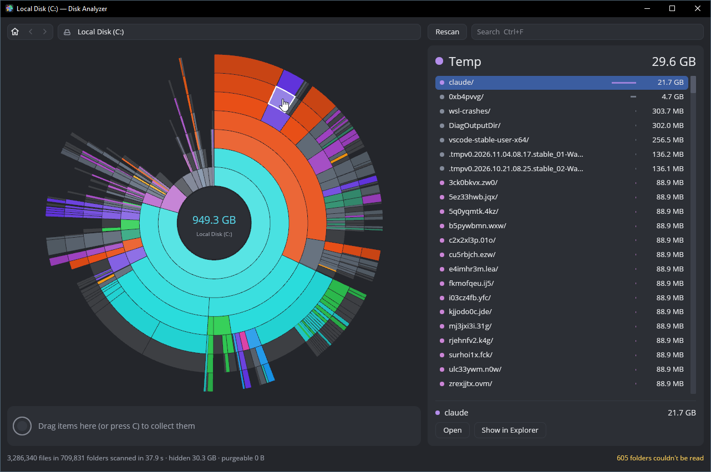

<p align="center">
  
</p>

<h1 align="center">Disk Analyzer</h1>

<p align="center">
  See what takes up space on your disk, and clean it up.<br>
  For macOS, Windows and Linux. Fast, local, no network access.<br>
  Inspired by <a href="https://daisydiskapp.com">DaisyDisk</a>.
</p>

<p align="center">
  
</p>

## Features

- Scans a whole disk or any folder in parallel and shows it as an interactive sunburst chart.
- Counts what a file really uses on disk. Hard links and cloned or reflinked copies count once.
- Shows the space a scan can't see, such as snapshots and purgeable space, as its own segment.
- Lets you search by name, collect files and move them to the Trash (Recycle Bin on Windows).

## Install

Download the file for your system from the
[latest release](https://github.com/Fee0/disk_analyzer/releases/latest).

| System | File | First launch |
|---|---|---|
| macOS 11+ | `.dmg` | Drag the app to *Applications*. The app isn't signed: on first launch, go to System Settings → Privacy & Security and click **Open Anyway**. |
| Windows 10+ | `.zip` | Run `disk-analyzer.exe`. If SmartScreen appears, click **More info → Run anyway**. |
| Linux | `.tar.gz` | Run `./install.sh` to add it to your app menu, or run `./disk-analyzer` directly. |

**Full disk scans:** on macOS, give the app *Full Disk Access* (System Settings →
Privacy & Security). On Windows and Linux, run it as administrator or root.
Folders it can't read are counted as hidden space.

## Usage

| Action | Shortcut |
|---|---|
| Open a folder | Double-click or Enter |
| Go up | Click the center or Ctrl+↑ |
| Back / forward | Mouse buttons or Backspace |
| Select | Click, arrow keys |
| Search | Ctrl+F (⌘F on macOS) |
| Collect for deletion | C, or drag onto the collector |

## Build from source

Requires [Rust](https://rustup.rs) 1.90 or later.

```sh
cargo run --release
```

## License

[MIT](LICENSE)
