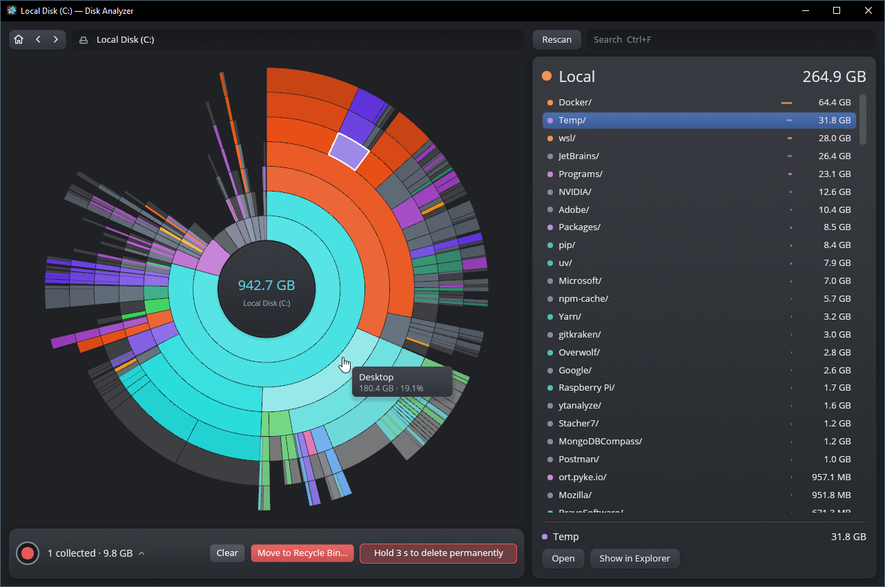
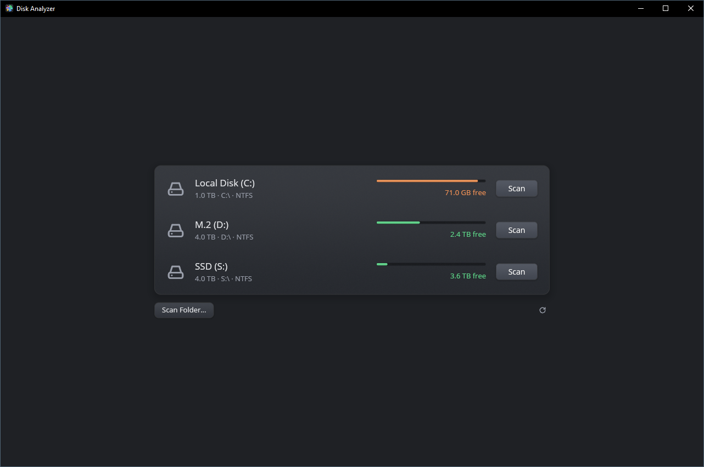

<p align="center">
  
</p>

<h1 align="center">Disk Analyzer</h1>

<p align="center">
  See what takes up space on your disk, and clean it up.<br>
  For macOS, Windows and Linux. Fast, local, no network access.<br>
  Inspired by <a href="https://daisydiskapp.com">DaisyDisk</a>.
</p>

<p align="center">
  
  
</p>

## Features

- **Scan disks and folders.** A scan uses every core. You can scan several disks
  or folders at once, and pause or stop each scan from its row.
- **Sunburst chart.** Each ring is one folder level, colored by file type: video,
  images, audio, archives, disk images, documents, code, apps, libraries and
  caches. Hover a segment for its size and share. Items too small to show are
  grouped together.
- **True sizes.** Counts the space files use on disk, not their nominal length.
  Hard links and cloned or reflinked copies count once.
- **Hidden space.** Space the scan can't see gets its own segment: snapshots,
  purgeable space on macOS, folders it couldn't read and file system metadata.
  Select it to see the likely causes and how to free that space.
- **Search.** Type a name to narrow the list to matching items. The chart
  highlights where they are.
- **Clean up.** Collect files and folders to delete. The chart shows your disk as
  it would be without them. System locations can't be collected.
- **Open results.** Going back to the start page keeps each result open, so you
  can switch between scans without scanning again.

## Install

Download the file for your system from the
[latest release](https://github.com/Fee0/disk_analyzer/releases/latest).

| System | File | First launch |
|---|---|---|
| macOS 11+ | `.dmg` | Drag the app to *Applications*. It is signed and notarized, so it opens without a warning. |
| Windows 10+ | `.zip` | Run `disk-analyzer.exe`. If SmartScreen appears, click **More info → Run anyway**. |
| Linux | `.tar.gz` | Run `./install.sh` to add it to your app menu, or run `./disk-analyzer` directly. |

**Full disk scans:** on macOS, give the app *Full Disk Access* (System Settings →
Privacy & Security). On Windows and Linux, run it as administrator or root.
Folders it can't read are counted as hidden space.

## Usage

Click **Scan** next to a disk, or **Scan Folder…** for any folder. To scan a
folder at launch, pass it as an argument: `disk-analyzer ~/Downloads`.

| Action | Windows and Linux | macOS | Mouse |
|---|---|---|---|
| Select | Arrow keys | Arrow keys | Click |
| Open the selected folder | Enter or Ctrl+↓ | Enter or ⌘↓ | Double-click |
| Go up a level | Ctrl+↑ | ⌘↑ | Click the center |
| Back | Backspace or Ctrl+[ | Backspace or ⌘[ | Back button |
| Forward | Ctrl+] | ⌘] | Forward button |
| Search | Ctrl+F | ⌘F | |
| Open the selected item | Space | Space (Quick Look) | |
| Collect for deletion | C | C | Drag onto the collector |
| Scan again | F5 or Ctrl+R | ⌘R | **Rescan** |
| Cancel, clear search, deselect | Esc | Esc | |

**Show in Explorer**, **Show in Finder** or **Show in File Manager** under the
selected item opens its folder.

### Cleaning up

Collected items wait in the collector at the bottom. Click it to see the list
and remove any you change your mind about. Then either:

- click **Move to Trash** (**Move to Recycle Bin** on Windows) and confirm, or
- hold **Hold 3 s to delete permanently** until it finishes. Letting go early
  cancels.

## Build from source

Requires [Rust](https://rustup.rs).

```sh
cargo run --release
```

## License

[MIT](LICENSE)
